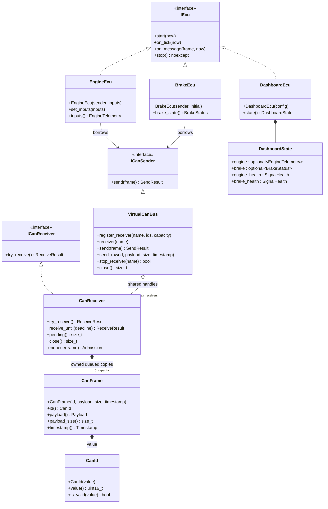
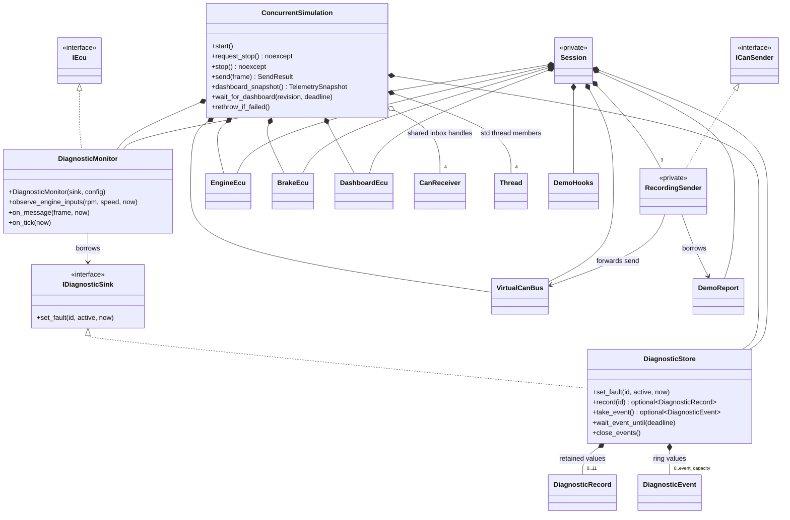
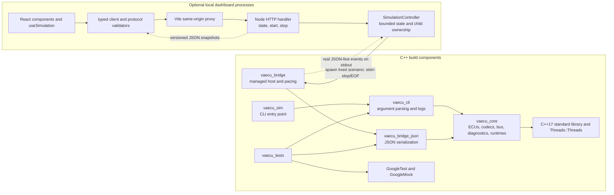

# Implementation-matched UML

Reviewed against headers, implementation, CMake targets and dashboard modules on
2026-10-14. Mermaid class/sequence diagrams use UML relationships; the component
view uses Mermaid flowchart boxes as UML-style components. They describe software
objects and dependencies, not physical ECU wiring. Method parameter/return types
are abbreviated; the linked headers are authoritative. Mermaid rendering has not
been executed in this restricted environment; source relationships were checked.

## Core classes



`CanReceiver`'s queued values are erased on close; shared receiver handles can
outlive the bus in a closed state. Frame composition denotes owned values rather
than independently allocated frame objects. `Payload` is a fixed
array of eight bytes. `Timestamp` is an alias, not an `IClock` class. ReceiveResult
is a variant of an owned CanFrame or Empty/Closed status; SendResult is admission
status/counts. No ECU has a dependency on another concrete ECU.

Sources: [ECU](../include/vaecu/ecu.hpp), [transport](../include/vaecu/can_transport.hpp),
[bus/inboxes](../include/vaecu/virtual_can_bus.hpp), [frames](../include/vaecu/can_frame.hpp),
[Engine](../include/vaecu/engine_ecu.hpp), [Brake](../include/vaecu/brake_ecu.hpp),
[Dashboard](../include/vaecu/dashboard_ecu.hpp).

## Diagnostics and runtime ownership



`Thread` is notation for `std::thread`, not a repository class. Session and
RecordingSender are private classes in the anonymous namespace of
`src/demo_scenario.cpp`. `run_demo_scenario` constructs that Session; it is not a
class. ConcurrentSimulation's four tasks are three ECUs and a diagnostic
observer. DiagnosticRecord/Event and DemoReport are value structures. The two
runtime owners are alternative entry paths; neither owns the other.

Sources: [diagnostics](../include/vaecu/diagnostics.hpp),
[concurrent owner](../include/vaecu/concurrent_simulation.hpp),
[scenario types](../include/vaecu/demo_scenario.hpp),
[private scenario implementation](../src/demo_scenario.cpp).

## Component dependencies and process boundary

Arrows mean "uses/depends on"; runtime replies/data are annotated separately.
Core code has no outgoing dependency on a presentation component. Canonical UML
component notation is also available as
[PlantUML source](diagrams/components.puml); the Mermaid view below is the
repository-readable overview. PlantUML rendering was not executed here.



Bridge/JSON targets and the test-to-JSON dependency exist only when
`VAECU_BUILD_BRIDGE=ON`; test components exist only with `BUILD_TESTING=ON`.
The frontend and Node server have separate processes; Node also starts one C++
child. HTTP uses ports 5173 (Vite) and 8080 (Node), both loopback. There is no
WebSocket, native CAN adapter or direct frontend-to-ECU pointer/state access.

Sources: [CMake](../CMakeLists.txt), [HTTP factory](../dashboard/server/http.ts),
[controller](../dashboard/server/controller.ts), [bridge main](../app/bridge_main.cpp),
[proxy](../dashboard/vite.config.ts), [client](../dashboard/src/api.ts).

## Normal communication, deterministic cycle at 250 ms

This shows the Normal scenario after its healthy initial cycle. Sensor
observation and recording hooks are omitted for readability. The two producer
senders are separate RecordingSender instances.

```mermaid
sequenceDiagram
  participant S as Session caller
  participant B as BrakeEcu
  participant E as EngineEcu
  participant R as RecordingSender instances
  participant Bus as VirtualCanBus
  participant Q as brake inbox
  participant DQ as dashboard inbox
  participant MQ as diagnostics inbox
  participant D as DashboardEcu
  participant M as DiagnosticMonitor
  S->>R: scenario send 0x300 Apply
  R->>Bus: send(frame)
  Bus->>Q: enqueue copied event
  Bus->>MQ: enqueue copied event
  Bus-->>R: Routed, delivered=2, dropped=0
  S->>Q: try_receive()
  Q-->>S: owned event frame
  S->>B: on_message(frame, now=250ms)
  Note over B: Applied state; no immediate transmission
  S->>E: on_tick(now)
  E->>R: send encoded 0x100 telemetry
  R->>Bus: send(frame)
  Bus->>DQ: enqueue copied telemetry
  Bus->>MQ: enqueue copied telemetry
  S->>B: on_tick(now)
  B->>R: send encoded 0x200 applied status
  R->>Bus: send(frame)
  Bus->>DQ: enqueue copied status
  Bus->>MQ: enqueue copied status
  loop Dashboard FIFO until Empty
    S->>DQ: try_receive()
    DQ-->>S: owned frame
    S->>D: on_message(frame, now)
  end
  loop Diagnostics FIFO until Empty
    S->>MQ: try_receive()
    MQ-->>S: owned frame
    S->>M: on_message(frame, now)
  end
  S->>D: on_tick(now)
  S->>M: on_tick(now)
  S->>D: state()
  D-->>S: copied fresh telemetry and applied brake state
```

The bus never calls `on_message`; Session dispatches. In concurrent mode the
corresponding worker dispatches after `receive_until`, so order between different
workers is not represented by this deterministic sequence.
Evidence: `Session::run`, `dispatch`, `RecordingSender::send` in
[src/demo_scenario.cpp](../src/demo_scenario.cpp);
[tested complete flows](../tests/demo_scenario_test.cpp).

## Fault detection and recovery, Recovery scenario

Brake publication continues throughout. Values below are default logical-time
thresholds, not measurements of real-time performance.

```mermaid
sequenceDiagram
  participant S as Session
  participant E as EngineEcu
  participant M as DiagnosticMonitor
  participant Store as DiagnosticStore
  participant Bus as Bus and diagnostics inbox
  S->>M: observe_engine_inputs(-1, 60, 250ms)
  M->>Store: set_fault(0x1001, true, 250ms)
  Note over S,E: Engine publication paused; last engine frame is at 0ms
  S->>M: observe_engine_inputs(-1, 60, 500ms)
  M->>Store: set_fault(0x1102, true, 500ms)
  Note over M,Store: Repeated active observations do not duplicate transitions
  S->>M: observe_engine_inputs(-1, 60, 1000ms)
  M->>Store: set_fault(0x1104, true, 1000ms)
  Note over S: Engine availability becomes offline at timeout
  S->>M: observe_engine_inputs(1500, 60, 1250ms)
  M->>Store: set_fault(0x1001, false, 1250ms)
  S->>E: set_inputs(1500, 60); on_tick(1250ms)
  E->>Bus: encoded 0x100 via RecordingSender
  Bus-->>S: owned frame from diagnostic inbox
  S->>M: on_message(frame, 1250ms)
  M->>Store: set_fault(0x1102, false, 1250ms)
  M->>Store: set_fault(0x1104, false, 1250ms)
  loop Drain recorded transitions each cycle
    S->>Store: take_event()
    Store-->>S: Raised or Recovered event
  end
  Note over Store: One retained record per fault, with separate occurrence and recovery times
```

Dashboard delivery at recovery is omitted; it uses the normal flow and restores
its Engine signal to Fresh. Missing means no accepted publication; stale means
an old accepted publication; communication timeout concerns reception activity.
Fault storage does not decide ECU state. Evidence:
[src/diagnostics.cpp](../src/diagnostics.cpp),
[scenario runner](../src/demo_scenario.cpp),
[recovery tests](../tests/demo_scenario_test.cpp).

## Concurrent shutdown, after startup release

Workers run concurrently; the parallel blocks express responsibilities, not a
fixed relative stop order. This diagram does not depict startup cancellation,
where diagnostic reporting can close before workers are released.

```mermaid
sequenceDiagram
  participant Caller
  participant R as ConcurrentSimulation
  participant Bus as VirtualCanBus
  participant Q as All CanReceiver inboxes
  participant E as Engine worker
  participant B as Brake worker
  participant D as Dashboard worker
  participant M as Diagnostic worker
  participant Store as DiagnosticStore
  Caller->>R: stop()
  Note over R: Serialize lifecycle controls
  R->>R: request_stop(); set atomic stopping
  R->>Bus: close()
  Bus->>Q: close(); discard pending; notify waiters
  R->>R: notify startup and snapshot waiters
  par Engine worker exit
    Q-->>E: receive_until interrupted or stopping observed
    E->>E: exit loop; EngineEcu.stop()
  and Brake worker exit
    Q-->>B: receive_until interrupted or stopping observed
    B->>B: exit loop; BrakeEcu.stop()
  and Dashboard worker exit
    Q-->>D: receive_until interrupted or stopping observed
    D->>D: stop DashboardEcu; publish final stale snapshot
  and Diagnostic worker exit
    Q-->>M: receive_until interrupted or stopping observed
    M->>M: stop DiagnosticMonitor
    M->>Store: close_events()
  end
  R->>E: join if joinable
  R->>B: join if joinable
  R->>D: join if joinable
  R->>M: join if joinable
  R->>Store: close_events() idempotently
  R-->>Caller: stopped; resources joined
```

Close discards CAN frames, but diagnostic close retains pending events and
records. Stop/destruction does not clear active faults. No thread is detached.
Evidence: [runtime implementation](../src/concurrent_simulation.cpp),
[queue implementation](../src/virtual_can_bus.cpp),
[shutdown/concurrency tests](../tests/concurrency_test.cpp).
